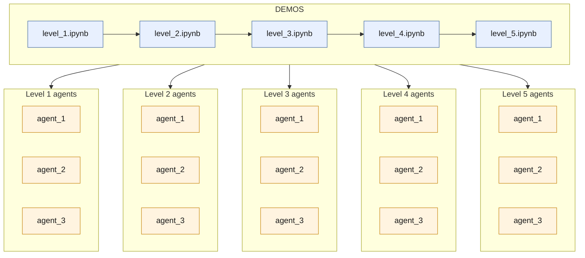

# DEMO: AI AGENT DATA FORMATS IN PYTHON

### Overview

The decision to make a demo about **Agents' data formats in Python** comes down to one realization. And that is : AI engineering is **all about data formats and structures**. Because most AI systems rely on **input-outputs**, a huge portion of the workload deals with data received from **APIs**, **user messages**, **prompt formats**, among others. Therefore, the foundational Python objects like **dicts** and **dataclasses** remain crucial, but even more importantly the text-type formats like **JSON** and LLM message formats like **OpenAI's** and **Claude's**. 

Since **learning means relearning**, I also made this project available to **everyone**. It serves as my own **reference** to come back to whenever a format slips my mind, and as a **shared resource** for anyone who struggles with the same concepts. Each demo contains **explanations** that reference **specific agents** inside the project, so one can revisit concepts both **conceptually** and **in practice**.

This is not a demo about Python basics but rather a **bridge between Python objects** (**dicts**, **lists**, **Pydantic models** etc.) and the **formats** AI agents actually exchange: **JSON**, **LLM message formats**, and **MLflow input/output schemas**. The goal is to build the intuition for **moving from one representation to another** (**serializing**, **validating**, **converting**, **parsing** etc.), because that's where most **bugs** in agent code appear.

### Concepts Covered

| Level | Topic | Concepts: what will be Covered | Status |
|---|---|---|---|
| 1 | Python Foundations | Dicts, Lists, JSON, Nested Structures, Dataclasses, and Pydantic | |
| 2 | API Message Formats | OpenAI, Anthropic, Databricks, and Converting between Them | |
| 3 | MLflow Schemas | String, Array, and Messages Inputs; plus Handling Schema Validation Errors | |
| 4 | Real Agent Calls | OpenAI Client, Databricks SDK, MLflow Pyfunc, Parsing Responses | |
| 5 | Evaluation Formats | Mlflow Evaluate (legacy) and GenAI Evaluate (New), Custom Scorers, LLM-as-Judge | |

### Implementation

#### How the Project Works

The project is organized into **5 demos**, one per learning level, and **3 small agents** that accompany them. Each demo is a notebook that introduces a few concepts, then applies them to the **same three agents** (`agent_1`, `agent_2`, `agent_3`), linked directly from the notebook. The concepts of each level are **spread across the agents** so you learn one idea at a time. For example, in Level 1, the first agent shows **dicts**, the second **lists**, and the third on dive deep in **JSON**; in Level 2, they show the **OpenAI**, then **Anthropic**, then **Databricks** message formats; and so on for the following levels. The three agents have the same file-naming pattern (for `agent_1`: `agent_data_1.py`, `tools_1.py` and `agent_1.py`), so we always know where we are at. It may feel like a lot at first, but you only need to follow one level at a time.

#### Illustration

### Technical Stack

### Setup